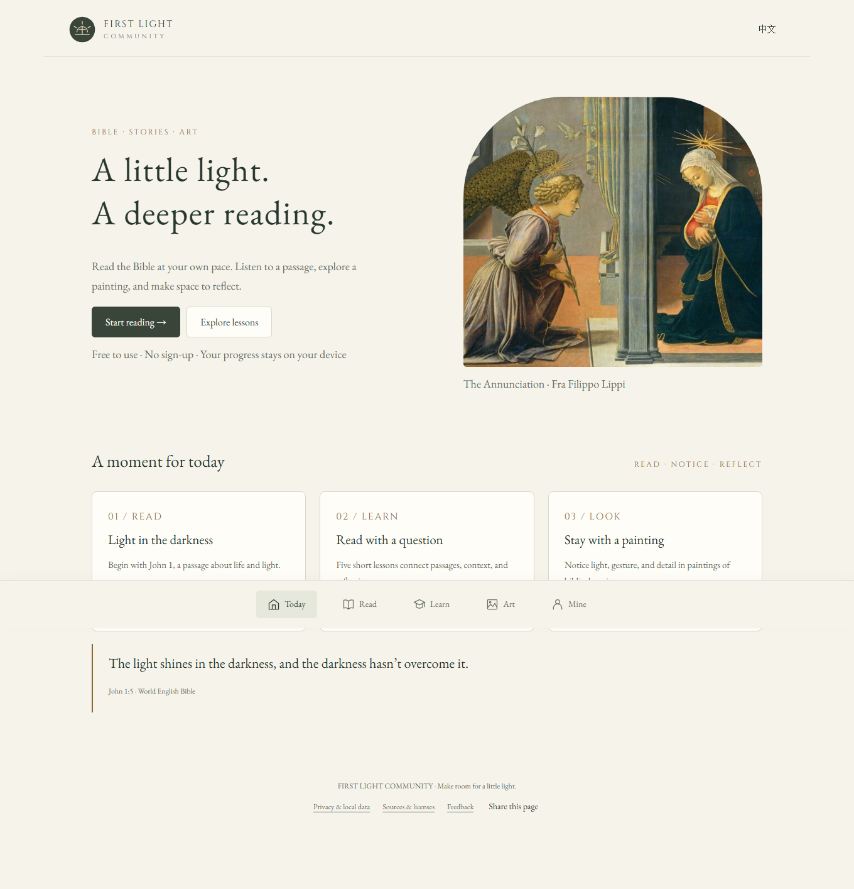

# First Light Community · Bible & Art

**A free English and Chinese Bible reader with art and short lessons. No sign-up.**

Curious about the story behind a biblical painting? Start with *The Finding of Moses*, notice a detail, then open the passage that inspired it. Or go straight to a chapter and read at your own pace. It works in your browser on a phone or computer.

**[Try The Finding of Moses →](https://vvchen1981-del.github.io/first-light-community/?lang=en#art/moses)** · [Read the Bible](https://vvchen1981-del.github.io/first-light-community/?lang=en#read/JHN/1) · [Try a short lesson](https://vvchen1981-del.github.io/first-light-community/?lang=en#learn/beginning)

[中文介绍](README.zh-CN.md) · [Report a problem or share an idea](https://github.com/vvchen1981-del/first-light-community/issues/new/choose)

[](https://vvchen1981-del.github.io/first-light-community/?lang=en#home)

## Your first few minutes

1. **Look:** open [The Finding of Moses](https://vvchen1981-del.github.io/first-light-community/?lang=en#art/moses). Use the looking prompt to notice a detail.
2. **Read:** follow the passage link to Exodus 2. Compare what the painting shows with what the text says.
3. **Keep or share:** save the artwork to revisit it, or use **Share this page** to send the same page and language to a friend.

Prefer a text-first start? [Begin with one chapter](https://vvchen1981-del.github.io/first-light-community/?lang=en#learn/beginning) offers a short reading and a question with feedback. You can explore without a GitHub account.

## Find a place to begin

- **Read in English or Chinese.** The World English Bible and simplified Chinese Union Version each contain 66 books and 1,189 chapters. Choose a book and chapter, search within a chapter, and return to your reading position.
- **Explore through art.** Four biblical artworks have source records, background, looking prompts, and links back to scripture.
- **Try a short lesson.** Five bilingual introductory lessons connect a passage, context, and a question, with feedback and local completion records.
- **Listen with your device.** Read a verse or chapter aloud; choose an available voice and adjust its speed. Voice availability, pronunciation, quality, and network requirements depend on your browser and operating system. This edition has no cloud TTS service; Chinese and English sound output and playback controls were verified on Windows Chrome; other browsers and devices still need their own checks.
- **Keep a personal reading trail.** Save bookmarks and artwork, track progress, and export or import a JSON backup. Records stay in the current browser; they do not automatically sync across devices.

New visitors start in English. Use the visible 中文 / English button to switch; your preference is saved, and shared links keep the chosen language. The interface supports phones, desktop screens, keyboard navigation, and visible focus.

## Free, simple, and local

This is an independent static community edition: no account, subscriptions, API keys, backend, advertising, or in-app analytics. Hosting providers may keep request logs, and some operating-system voices use online services. See [Privacy](PRIVACY.md) for details and instructions to delete local records. Keep exported personal backups private.

The site does not promise offline installation. A first visit and uncached books need an internet connection. You can download the source and run it locally to read without internet; device speech may still need a network. GitHub Pages availability and loading speed vary by network and region.

The community edition does not include the full native iOS app, cloud speech, church search, intro films, or the full art collection.

## Help make it more useful

[Rate your experience](https://github.com/vvchen1981-del/first-light-community/issues/new?template=review.yml): share an overall score, whether you would return, and one thing to improve. Reviews are public and require a GitHub account.

You are welcome to use the site without a GitHub account. If you have one, [share a problem or suggestion in English or Chinese](https://github.com/vvchen1981-del/first-light-community/issues/new/choose). Tell us what you tried, what happened, and your browser/device. A clear report about a confusing button, awkward translation, or device voice can help as much as code.

To share First Light, send someone the [reading link](https://vvchen1981-del.github.io/first-light-community/#read/JHN/1), [lessons](https://vvchen1981-del.github.io/first-light-community/#learn), or [gallery](https://vvchen1981-del.github.io/first-light-community/#art). A repository star is optional if you want to find the project again.

See [Contributing](CONTRIBUTING.md) for content, translation, accessibility, and code contributions. Please leave private reading notes, backups, passwords, and tokens out of public issues and pull requests.

## Share a place to start

Know someone interested in biblical art, reading in two languages, or a simple Bible reader? Send them a specific page they might enjoy:

> What do you notice first in *The Finding of Moses*? First Light pairs the painting with its story and a passage from Exodus. It is free to explore in English or Chinese, with no account needed.
>
> [Open the painting and story](https://vvchen1981-del.github.io/first-light-community/?lang=en#art/moses)

[English and Chinese sharing text](docs/SHARE.md) · [What this edition offers](https://github.com/vvchen1981-del/first-light-community/releases) · [How we evaluate improvements](docs/ADOPTION.md)

## Run locally

Install Node.js 22 or newer, then run inside this folder:

```sh
npm start
```

Open **http://127.0.0.1:4340/**. No `npm install` is needed: there are no npm dependencies. On Windows, you can also double-click `START.cmd`. Browsers restrict module and data loading over `file://`, so use the local server.

```sh
npm test
npm run build
node scripts/serve.mjs --dist
```

The build copies an explicit public-file allowlist into `dist/`. Set `PORT` to choose another port. [Validation notes](docs/VALIDATION.md) describe the checks and their limits; a successful automated check does not establish audible speech quality.

## Deploy your own copy

The public app is at **[First Light Community](https://vvchen1981-del.github.io/first-light-community/)**. The [deployment workflow](https://github.com/vvchen1981-del/first-light-community/actions/workflows/pages.yml) shows its verification and deployment runs.

For your own GitHub Pages copy:

1. Create or fork a repository and use a `main` branch. If uploading files, upload this folder's contents, including `.github/workflows/pages.yml`.
2. In **Settings → Pages → Build and deployment**, choose **GitHub Actions**.
3. Push to `main`. The workflow checks the data, builds the static site, and deploys it. Pull requests run checks without deployment.
4. Open the deployment URL shown by your workflow. Forks need their own Pages configuration.

Upload only the community project, keeping parent workspaces, personal backups, private environment files, and other app versions outside the repository. Resources use relative paths and navigation uses hash routes, supporting repository subpaths. The local server also supports `/community/` for subpath checks. See [GitHub's Pages workflow guide](https://docs.github.com/en/pages/getting-started-with-github-pages/using-custom-workflows-with-github-pages).

## Sources and license

Application code and original short guide text are [MIT licensed](LICENSE). Scripture, images, and fonts retain their own terms; the MIT license does not relicense them. See [Third-party notices](THIRD_PARTY_NOTICES.md) for publisher sources, museum object pages, image rights, and font notices. The shipped scripture preserves its source text and original verse numbering, including Chinese verse bridges. Both editions use the 66-book scope; this does not describe every Christian tradition's canon.

The four museum images are credited to the National Gallery of Art, Washington. Guide text distinguishes scripture, historical context, and editorial looking prompts. No institution endorses this application.

## Project map

```text
index.html / app.js / styles.css  application
data/bible/                      edition data and provenance
data/art.json                    four artworks and bilingual guides
data/lessons.json                five learning units
assets/art/                      attributed artwork images
assets/fonts/                    local subsets and OFL notices
scripts/                         local server and allowlisted build
tests/                           content and public-resource checks
.github/workflows/pages.yml      verification and deployment
```
